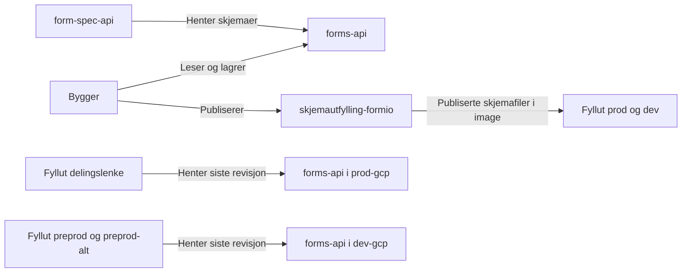

# Systemoversikt

Monorepoet inneholder Bygger for å lage skjemaer, Fyllut for å fylle dem ut,
form-spec-api og Sendinn. Bygger, Fyllut og Sendinn har hver sin frontend og backend.
Fellespakker deles mellom applikasjonene og deployes ikke som egne tjenester.

Oversikten beskriver oppsettet i deploy-konfigurasjonen, ikke verifisert driftsstatus.

## Instanser og miljøer

Alle instansene ligger i namespace `skjemadigitalisering`. `preprod` og
`preprod-alt` er to testoppsett i samme cluster, ikke egne clustere.

| Applikasjon   | Miljø                 | Cluster    | Applikasjonsnavn i Nais                                   |
| ------------- | --------------------- | ---------- | --------------------------------------------------------- |
| Bygger        | Produksjon            | `prod-gcp` | `skjemabygging`                                           |
| Bygger        | Preprod / preprod-alt | `dev-gcp`  | `skjemabygging-preprod` / `skjemabygging-preprod-alt`     |
| Fyllut        | Produksjon            | `prod-gcp` | `skjemautfylling`                                         |
| Fyllut        | Dev                   | `dev-gcp`  | `skjemautfylling`                                         |
| Fyllut        | Delingslenke          | `dev-gcp`  | `skjemautfylling-delingslenke`                            |
| Fyllut        | Preprod / preprod-alt | `dev-gcp`  | `skjemautfylling-preprod` / `skjemautfylling-preprod-alt` |
| form-spec-api | Produksjon            | `prod-gcp` | `form-spec-api`                                           |
| form-spec-api | Preprod / preprod-alt | `dev-gcp`  | `form-spec-api-preprod` / `form-spec-api-preprod-alt`     |
| Sendinn       | Preprod / preprod-alt | `dev-gcp`  | `sendinn-preprod` / `sendinn-preprod-alt`                 |

Sendinn har ingen produksjonskonfigurasjon her. Det er ikke samme applikasjon som
[send-inn-frontend](https://github.com/navikt/send-inn-frontend), som ligger i et eget repo.

## Skjemaer og publisering

[forms-api](https://github.com/navikt/forms-api) lagrer skjemadefinisjoner og
oversettelser. Tjenesten ligger utenfor monorepoet, i namespace `fyllut-sendinn`.
Bygger og form-spec-api bruker normalt forms-api i samme cluster.
Bygger i preprod og preprod-alt har også en separat kobling til produksjonens forms-api.

Fyllut har to måter å hente skjemadefinisjoner på:

- Produksjon og dev bruker `FORMS_SOURCE=static` og leser publiserte filer som følger med imaget.
- Delingslenke, preprod og preprod-alt bruker `FORMS_SOURCE=formsapi-staging` og
  henter siste revisjon fra forms-api. Denne kan inneholde upubliserte endringer.

Endringer i Bygger vises dermed først i dev etter publisering og deploy.

## Delingslenke

Fra Bygger kan skjemaansvarlige kopiere en lenke til
`https://skjemadelingslenke.ekstern.dev.nav.no/fyllut` for å dele og teste skjemaet
før publisering. Instansen kjører i `dev-gcp`, men henter skjemadefinisjoner fra
produksjonens forms-api. Innsending går mot testtjenester.

Lenken velger i dag ikke en fast revisjon. Endringer i Bygger kan derfor endre
skjemaet som åpnes fra samme lenke. Støtte for å velge historiske revisjoner er
ikke en del av dagens oppsett.

## Applikasjonskode og deploy

Dette repoet bygger Bygger og Fylluts baseimage, `fyllut-base`, og eier
Nais-konfigurasjonen for begge. Bygger deployes til produksjon fra `main`.
Den manuelle deploy-workflowen deployer testoppsettene for Bygger, Fyllut,
form-spec-api og Sendinn til preprod eller preprod-alt.

Fyllut prod, dev og delingslenke deployes derimot fra
[skjemautfylling-formio](https://github.com/navikt/skjemautfylling-formio).
Det repoet kombinerer baseimaget med publiserte skjemaer, oversettelser og ressurser.
Det henter Nais-konfigurasjonen fra den pinnede monorepo-commiten.
Preprod og preprod-alt kjører baseimaget direkte fra dette repoets deploy.

Skjemarevisjon og applikasjonsversjon er uavhengige. Bruk `MONOREPO_GIT_SHA` for å
identifisere Fylluts applikasjonskode, siden `GIT_SHA` har ulik betydning mellom miljøene.

## Kilder og detaljer

- [Nais-konfigurasjon](../.nais/) og [deploy-workflows](../.github/workflows/).
- [Fylluts deploy-oppsett](../.github/skills/fyllut-deploy-topology/SKILL.md).
- [Lasting av skjemadefinisjoner](../.github/skills/form-definition-loading/SKILL.md).
- [Lokal utvikling](../README.md#-utvikling).
